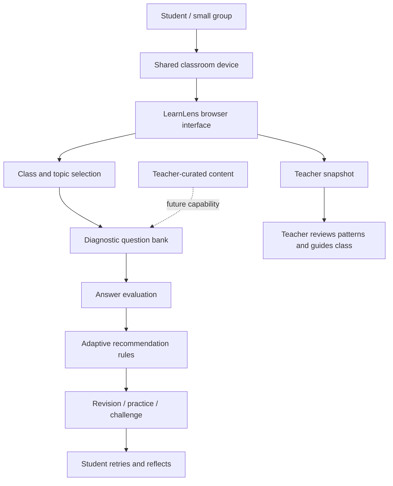

# LearnLens — Architecture

## Components
- **Browser UI:** student setup, questions, explanations, result and teacher snapshot.
- **Question bank:** illustrative topic questions.
- **Answer evaluator:** checks selected answer against answer key.
- **Recommendation rules:** score below 50% → guided revision; 50–99% → standard practice; 100% → challenge.
- **Teacher snapshot:** sample aggregate values, not actual learner data.

## Data flow
1. Learner selects class, subject and topic on a shared device.
2. Browser loads a short topic quiz.
3. Learner answers and sees an explanation.
4. Browser calculates score and recommends a next activity.
5. Teacher uses the separate sample snapshot to guide discussion.

## Privacy and inclusion
No student name, phone, email or account is requested. This static demo does not transmit answers to a server. Teacher dashboard values are sample data. Shared-device use should be supervised.

## Production evolution
A real deployment needs teacher authentication, curriculum-reviewed content, secure role-based storage, consent and retention policies, accessibility and language testing, offline synchronization, and evaluation with teachers and learners. These capabilities are not implemented here.

The score thresholds are demonstration rules, not validated learning standards.
